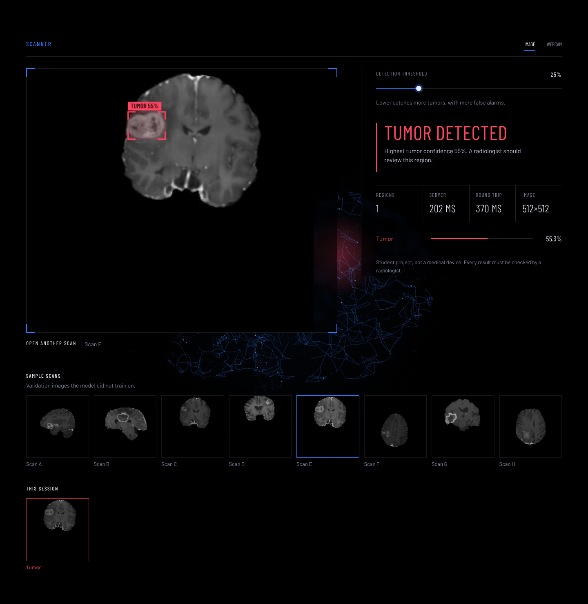

# 🧠 NeuroScan — Détection de tumeurs cérébrales (YOLO11 + MLOps)

Projet de module **Deep Learning Avancé — Industrialisation Vision & MLOps** — Axe 3 : détection d'objets en temps réel.

Un modèle **YOLO11** pré-entraîné sur COCO est *fine-tuné* (transfer learning) sur des IRM/CT cérébrales
pour localiser les tumeurs. Il est exporté en **ONNX** (+ variantes **FP16** et **INT8**), servi par une
API **FastAPI** asynchrone et utilisé depuis une application **React** (glisser-déposer, galerie, webcam).
Données et poids sont versionnés par **DVC**, les expériences suivies dans **MLflow**.

> ⚠️ Projet pédagogique — ce n'est pas un dispositif médical.

📄 Rapport technique : [`rapport_technique.pdf`](rapport_technique.pdf) (sources LaTeX dans `report/`).



## Démarrage en une commande

```bash
docker compose up --build
```

| Service | URL |
|---|---|
| Application React | http://localhost:3000 |
| API (Swagger) | http://localhost:8000/docs |
| MLflow | http://localhost:5000 |

L'API lit `models/best.onnx` monté en volume : lancer `dvc pull` (ou `dvc repro`) avant.

## Architecture

```
            ┌──────────── Pipeline d'entraînement (dvc repro) ─────────────┐
            │  src/data/dataset.py ─► src/models/train.py ─► src/models/evaluate.py │
            │  (téléchargement,      (YOLO11, MLflow)       (ONNX FP32/FP16/INT8,   │
            │   MD5 vérifié)                                  mAP, latence, Registry)│
            └───────────────────────────────┬──────────────────────────────┘
                                            │ models/best.onnx + metadata.json
   docker compose up                        ▼
   ┌───────────────┐   /api/*   ┌───────────────────────┐     ┌──────────────┐
   │ React + nginx │ ─────────► │ FastAPI + ONNX Runtime │     │ MLflow server│
   │  :3000        │            │  :8000  (/docs)        │     │  :5000       │
   └───────────────┘            └───────────────────────┘     └──────────────┘
```

```
.github/workflows/   ci-tests.yml (lint + tests + build), docker-build.yml (images + smoke test)
src/data/dataset.py        téléchargement, vérification MD5, chargement des splits
src/models/architecture.py définition YOLO11 (transfer learning), config d'ablation
src/models/train.py        entraînement + tracking MLflow
src/models/evaluate.py     export ONNX, quantification FP16/INT8, mAP, benchmark, Model Registry
src/utils/                 common (chemins, MLflow), metrics (mAP NumPy), compare_runs, report_numbers
backend/app/               main.py (routes), schemas.py (Pydantic), inference.py (ONNX + NMS NumPy)
backend/tests/             22 tests pytest (API, endpoints, inférence)
frontend/src/              App, composants (Scanner, Readout, Webcam, BrainCanvas), api.js
report/                    rapport LaTeX (chiffres générés depuis reports/)
```

## Installation (entraînement)

```bash
python -m venv .venv
# Windows : .venv\Scripts\activate   |   Linux/Mac : source .venv/bin/activate
pip install -r requirements.txt
```

> **GPU NVIDIA** : installe d'abord PyTorch avec CUDA depuis https://pytorch.org.

## 1. Pipeline DVC + MLflow

```bash
docker compose up -d mlflow      # serveur MLflow sur http://localhost:5000
dvc repro                        # prepare -> train -> export
dvc push                         # sauvegarde données + poids sur le remote DVC
```

| Étape | Commande | Sorties |
|---|---|---|
| `prepare` | `python -m src.data.dataset` | `data/brain-tumor/` |
| `train` | `python -m src.models.train` | `models/best.pt`, `reports/metrics.json`, `reports/figures/` |
| `export` | `python -m src.models.evaluate` | `models/best{,_fp16,_int8}.onnx`, `models/metadata.json`, `reports/export.json` |

L'étape `export` enregistre le modèle ONNX dans le **Model Registry** (`brain-tumor-detector`) et lui donne
l'alias `production` (stage « Production »).

**Remote DVC** : `.dvc/config` pointe vers `../dvc-storage` (dossier à côté du projet). Pour Google Drive :
`dvc remote add -d -f storage gdrive://<id-du-dossier>`.

**Version du dataset** : l'archive Ultralytics a changé le 15/11/2026 (2 classes → 1 classe `tumor`,
994 train / 121 val). Son MD5 est fixé dans `params.yaml` (`data.md5`) : si l'archive change encore,
`prepare` s'arrête au lieu d'entraîner en silence sur d'autres données.

### Ligne de base vs modèle avancé

```bash
dvc exp run --temp train -S train.augment=false   # ablation : sans augmentation
dvc exp run --temp train -S train.model=yolo11s.pt # modèle plus gros
python -m src.utils.compare_runs                  # tableau + graphique -> reports/comparison.*
```

`--temp` exécute l'expérience à part : le modèle servi n'est pas modifié.

### Sans serveur MLflow (ex. Colab)

```bash
MLFLOW_TRACKING_URI=sqlite:///mlflow.db dvc repro          # Linux / Mac / Colab
$env:MLFLOW_TRACKING_URI="sqlite:///mlflow.db"; dvc repro  # Windows PowerShell
```

## 2. API

| Route | Rôle |
|---|---|
| `GET /health` | état, GPU disponible, version du modèle chargé |
| `GET /model/metadata` | architecture, classes, métriques de validation, benchmark |
| `POST /predict` | image → boîtes + scores (JSON) + temps d'inférence |
| `POST /predict/visualize` | image → PNG annoté (une couleur par classe) |

Erreurs : 400 (image illisible), 413 (> 10 Mo), 415 (pas une image), 422 (paramètre invalide),
503 (modèle non chargé).

### Mode développement (sans Docker)

```bash
cd backend && pip install -r requirements-dev.txt
MODEL_PATH=../models/best.onnx LABELS_PATH=../models/labels.json METADATA_PATH=../models/metadata.json uvicorn app.main:app --reload
cd frontend && npm install && npm run dev      # http://localhost:5173
```

## 3. Tests & CI

```bash
cd backend && ruff check . && ruff format --check . && pytest -v
cd frontend && npm run lint && npm run build
ruff check src && ruff format --check src
```

GitHub Actions, à chaque push :
- `ci-tests.yml` — ruff + pytest (API), ESLint + build (frontend), ruff (code d'entraînement), `dvc dag` ;
- `docker-build.yml` — build des images (Dockerfiles multi-étapes) et smoke test de `/health`.

## 4. Rapport technique

```bash
python -m src.utils.compare_runs     # après les expériences
python -m src.utils.report_numbers   # chiffres -> report/numbers.tex, report/comparison.tex
cd report && pdflatex rapport_technique.tex && pdflatex rapport_technique.tex
```

## Choix techniques (à savoir expliquer)

- **Transfer learning** : poids COCO → environ 1 000 images suffisent.
- **YOLO11n** : YOLO11s (3,6× plus gros) n'a pas fait mieux sur ce petit jeu de données ; YOLO11n est le plus rapide sur CPU.
- **ONNX Runtime** : l'image API n'embarque ni PyTorch ni Ultralytics. Pré/post-traitement (letterbox,
  décodage, NMS) réécrits en NumPy dans `backend/app/inference.py` — mêmes prédictions qu'Ultralytics.
- **Quantification** : INT8 statique (QDQ, calibré sur 100 images) avec le décodage de la tête gardé en FP32 ;
  FP16 pour GPU. Comparatif dans `reports/export.json`.
- **Recall > precision** : rater une tumeur est plus grave qu'une fausse alerte → seuil réglable dans l'UI.
- **Frontend** : Tailwind CSS v4 (sans preflight) branché sur les tokens du design ; latence serveur + aller-retour client.
- **Limite connue** : le split train/val n'est pas fait par patient → scores possiblement optimistes.
